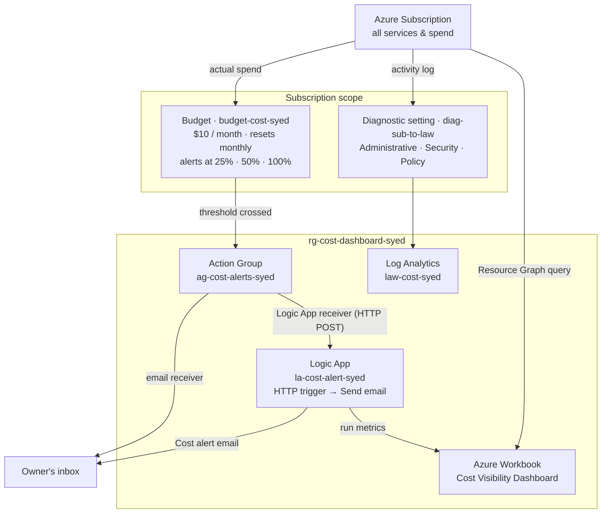

# 💰 Azure Cost Visibility Dashboard

**Status:** ✅ Complete — budget alerts deployed with Terraform, Logic App email notifications tested, and Workbook dashboard built

Cost tracking and alerting for an Azure subscription: a monthly Cost Management budget with alerts at 25%, 50%, and 100% of spend, an Action Group that emails the owner and triggers a Logic App notification workflow, subscription activity logs centralized in Log Analytics, and an Azure Workbook dashboard in the portal. Infrastructure — including the Logic App's HTTP trigger and its connection to the Action Group — is Terraform; only the email step and the Workbook are built in the portal.

## 🎬 Video Walkthrough

> 🎥 **Loom walkthrough:** [Watch the full build (≈6 min)](https://loom.com/share/8ecc371cb90b49d69a82d55d141538bc)

## 📖 Project Overview

Small businesses move to the cloud expecting it to be cheaper — then the bills arrive full of line items like `Microsoft.Compute/virtualMachines` that nobody can interpret, predict, or explain. By the time someone notices a cost spike, the money is already spent.

This project gives the owner visibility before the bill becomes a problem:

- **A monthly budget on the whole subscription** — resets on the first of every month, matching how Azure bills.
- **Early, staged warnings** — emails at 25%, 50%, and 100% of the budget, so there's time to act instead of a single surprise at the end.
- **A notification workflow** — budget alerts also call a Logic App over HTTP, which sends a formatted alert email and keeps a run history that shows up on the dashboard.
- **A dashboard in the portal** — an Azure Workbook showing resource groups across the subscription and alert workflow activity.
- **An audit trail** — every management operation on the subscription (who created, changed, or deleted what) flows into Log Analytics.

**Business outcome:** the owner hears about spend at a quarter of the budget, not after the invoice lands.

### Skills Demonstrated

- Infrastructure as Code with Terraform (`azurerm` provider), including subscription-scoped resources
- Azure Cost Management budgets (`azurerm_consumption_budget_subscription`) with multiple actual-spend thresholds
- Azure Monitor Action Groups with email and Logic App receivers
- Logic Apps — HTTP request trigger → Send email
- Subscription activity log diagnostic settings to Log Analytics
- Azure Workbooks with Azure Resource Graph queries and Logic App run metrics
- Handling Terraform drift on time-based values (`timestamp()` + `lifecycle { ignore_changes }`)

## 🏗️ Architecture Diagram



The budget and the diagnostic setting live at **subscription** scope, not in the resource group — they watch everything in the subscription, not just this project.

## ✅ Prerequisites

| Requirement | How to verify (PowerShell) |
|---|---|
| Azure CLI installed and signed in | `az account show` |
| Terraform v1.5+ | `terraform -version` |
| Owner, Contributor, or **Cost Management Contributor** on the subscription (budgets are subscription-scoped) | `az role assignment list --assignee $(az account show --query user.name -o tsv) --scope /subscriptions/$(az account show --query id -o tsv) -o table` |
| An email account for the Logic App connector (Outlook.com for a personal Microsoft account; Office 365 Outlook for a work/school account) | — |

> 💰 **Cost:** essentially free — budgets, Action Groups, and Workbooks cost nothing, and the Logic App and Log Analytics workspace run at a few cents for lab-scale usage.

## 📁 Repository Structure

```
.
├── main.tf                     # RG, Log Analytics, Action Group (email + Logic App receivers), budget, Logic App + HTTP trigger, diagnostic setting
├── variables.tf                # yourname, location, alert_email, tags
├── outputs.tf                  # RG name, workspace ID, Logic App callback URL (sensitive), Action Group ID
├── terraform.tfvars.example    # Copy to terraform.tfvars (gitignored) and fill in
├── .terraform.lock.hcl         # Pinned provider version
└── .gitignore                  # Excludes *.tfvars, state, .terraform/
```

## 🏷️ Naming Conventions

All names use the `yourname` suffix from `terraform.tfvars` — `syed` in my deployment.

| Resource | Name |
|---|---|
| Resource Group | `rg-cost-dashboard-syed` |
| Log Analytics Workspace | `law-cost-syed` |
| Action Group | `ag-cost-alerts-syed` (short name `costalerts`) |
| Budget (subscription scope) | `budget-cost-syed` |
| Logic App | `la-cost-alert-syed` |
| Diagnostic Setting (subscription scope) | `diag-sub-to-law` |
| Workbook (created in portal) | `Cost Visibility Dashboard` |

## 📊 Budget Design

| Setting | Value |
|---|---|
| Scope | Whole subscription (`data.azurerm_subscription.current.id`) |
| Amount | **$10 / month** |
| Time grain | `Monthly` — resets on the 1st of each calendar month |
| Start date | First day of the month Terraform is first applied |
| Threshold type | `Actual` spend (not forecast) |
| Notification target | `ag-cost-alerts-syed` |

| Threshold | Fires when actual monthly spend exceeds |
|---|---|
| 25% | $2.50 |
| 50% | $5.00 |
| 100% | $10.00 |

The $10 amount is set low on purpose for a lab subscription, so the thresholds are reachable and the alert path can actually be observed. For a real business, raise `amount` in `main.tf` to the monthly figure the owner expects.

## 🔧 Changes from the Base Lab Guide

| Area | Base guide | This repo | Why |
|---|---|---|---|
| Budget amount | `amount = 200` ($50 / $100 / $200 alerts) | `amount = 10` ($2.50 / $5 / $10 alerts) | Thresholds a low-spend lab subscription can realistically reach |
| Budget scope | `data.azurerm_client_config.current.subscription_id` (bare GUID) | `data.azurerm_subscription.current.id` (`/subscriptions/<guid>`) | The budget resource expects the full subscription resource ID; a bare GUID fails to parse |
| Start date | Hard-coded `"2026-03-01T00:00:00Z"` | `formatdate("YYYY-MM-01'T'00:00:00Z", timestamp())` | Always the first of the current month, so it never goes stale and triggers `BudgetStartDateInvalid` |
| Start date drift | — | `lifecycle { ignore_changes = [time_period] }` | `timestamp()` changes on every run; without this, every `plan` would want to modify the budget |
| Logic App ↔ Action Group | HTTP trigger built in the designer, receiver added with `az monitor action-group update` | `azurerm_logic_app_trigger_http_request` + `logic_app_receiver` block in Terraform | The whole alert path is code, so a later `terraform apply` can't drop the receiver, and Windows `cmd.exe` never mangles the callback URL |
| Region | `East US` | `centralus` | Region used for this deployment |

## 🪜 Deployment Steps

### Step 1 — Clone and configure

```powershell
git clone https://github.com/salmanshah4/Cost-Dashboard.git
```

```powershell
cd Cost-Dashboard
```

```powershell
Copy-Item terraform.tfvars.example terraform.tfvars
```

Edit `terraform.tfvars`:

```hcl
yourname    = "<your-lowercase-name>"
location    = "centralus"
alert_email = "<you@example.com>"
```

### Step 2 — Deploy

```powershell
az login
```

```powershell
terraform init
```

```powershell
terraform plan "-out=main.tfplan"
```

```powershell
terraform apply main.tfplan
```

Expect 7 resources: resource group, Log Analytics workspace, Action Group, budget, Logic App, its HTTP trigger, and the diagnostic setting. Quote the `-out=` argument in PowerShell, otherwise it splits on the period.

> Right after apply, Azure Monitor emails a confirmation that your address was added to `ag-cost-alerts-syed`. That's expected.

### Step 3 — Add the email step to the Logic App

Terraform already created the **When a HTTP request is received** trigger and connected it to the Action Group. The only manual piece is the email action, because email connectors need an interactive sign-in. In `la-cost-alert-syed` → **Logic app designer**:

1. Under the existing HTTP trigger, add **Send an email (V2)** — Outlook.com for a personal Microsoft account, Office 365 Outlook for a work/school account:
    - **To:** your alert email
    - **Subject:** `Azure Cost Alert — Budget Threshold Reached`
    - **Body:** the trigger's **Body** from dynamic content (the full alert payload)
2. **Save**. Leave the trigger itself as it is — it's managed by Terraform.

**Test it directly:**

```powershell
$url = terraform output -raw logic_app_callback_url
```

```powershell
Invoke-RestMethod -Method Post -Uri $url -ContentType 'application/json' -Body '{"test":"Budget threshold reached"}'
```

The email should arrive within a minute, and the run shows as **Succeeded** in the Logic App's run history.

### Step 4 — Verify the Action Group wiring

```powershell
az monitor action-group show --name ag-cost-alerts-syed --resource-group rg-cost-dashboard-syed --query "{Email:emailReceivers[].emailAddress, LogicApp:logicAppReceivers[].name}" -o json
```

Expected: your email address and `la-webhook`. Then use **Test action group** in the portal (Monitor → Action groups → `ag-cost-alerts-syed`) to fire a sample notification through both the email receiver and the Logic App.

### Step 5 — Build the Workbook dashboard

Portal → **Monitor → Workbooks → + New**:

1. **Add query** → Data source **Azure Resource Graph** → select your **subscription** as the resource scope (the query won't run without one):

    ```kusto
    resourcecontainers
    | where type == "microsoft.resources/subscriptions/resourcegroups"
    | project resourceGroup, location
    ```

2. **Add metric** → resource type **Logic App** → `la-cost-alert-syed` → **Runs Succeeded** and **Runs Failed**. (Cost Management doesn't publish Azure Monitor metrics, so it isn't available as a metric source.)
3. **Save** as `Cost Visibility Dashboard` in `rg-cost-dashboard-syed`.

### Step 6 — Check the activity log in Log Analytics

Portal → `law-cost-syed` → **Logs**:

```kusto
AzureActivity
| where TimeGenerated > ago(1d)
| summarize Operations = count() by ResourceGroup, OperationNameValue
| order by Operations desc
```

Your own Terraform deployment should appear here (it can take several minutes after the diagnostic setting is created).

## 🎞️ Build Walkthrough (Loom timestamps)

**1. Prepare the Terraform project and review the working files** — [0:16](https://loom.com/share/8ecc371cb90b49d69a82d55d141538bc?t=16)


The project in VS Code with `main.tf`, `variables.tf`, and `outputs.tf`, and the `terraform plan` / `apply` workflow.

**2. Define the required variables and outputs** — [0:48](https://loom.com/share/8ecc371cb90b49d69a82d55d141538bc?t=48)


Alert email, location, name, and tags defined; outputs return the resource group, workspace, Logic App endpoint, and Action Group after apply.

**3. Build the core Azure resources in `main.tf`** — [1:20](https://loom.com/share/8ecc371cb90b49d69a82d55d141538bc?t=80)


Resource group, Log Analytics workspace, Action Group, budget, Logic App, and the subscription diagnostic setting.

**4. Deploy and verify the resources in the portal** — [1:39](https://loom.com/share/8ecc371cb90b49d69a82d55d141538bc?t=99)


Everything provisioned in `rg-cost-dashboard-syed`, with the alert email confirmed on the Action Group.

**5. Configure the Logic App workflow for alert notifications** — [1:46](https://loom.com/share/8ecc371cb90b49d69a82d55d141538bc?t=106)


HTTP request trigger plus a Send email action; the HTTP POST URL is saved for the alerting path.

**6. Test the alert workflow and confirm email delivery** — [2:10](https://loom.com/share/8ecc371cb90b49d69a82d55d141538bc?t=130)


Test request sent to the endpoint and the alert email confirmed in the inbox.

**7. Configure budget thresholds and notification levels** — [3:16](https://loom.com/share/8ecc371cb90b49d69a82d55d141538bc?t=196)


Subscription-level budget with notifications at 25%, 50%, and 100%, each wired to the Action Group.

**8. Set the budget time grain and monthly reset** — [4:06](https://loom.com/share/8ecc371cb90b49d69a82d55d141538bc?t=246)


`Monthly` time grain with the start date computed as the first of the current month, so tracking resets every calendar month.

**9. Review the Workbook dashboard** — [4:54](https://loom.com/share/8ecc371cb90b49d69a82d55d141538bc?t=294)


The Workbook showing alert workflow run status — succeeded and failed runs — alongside the subscription's resource groups.

**10. Send activity logs to Log Analytics** — [5:07](https://loom.com/share/8ecc371cb90b49d69a82d55d141538bc?t=307)


Subscription diagnostic setting forwarding Administrative, Security, and Policy activity logs into `law-cost-syed`.

**11. Validate the full deployment** — [5:23](https://loom.com/share/8ecc371cb90b49d69a82d55d141538bc?t=323)


Resource group, workspace, Logic App, budget alerts, Workbook, and diagnostic settings all present and connected.

## ✅ Verification Checklist

- [x] Resource group `rg-cost-dashboard-syed` exists
- [x] Budget `budget-cost-syed` appears in **Cost Management → Budgets** with 25% / 50% / 100% alerts
- [x] Action Group `ag-cost-alerts-syed` has an email receiver (confirmed) and a Logic App receiver
- [x] Logic App `la-cost-alert-syed` is Enabled with an HTTP trigger and Send email action
- [x] Test request to the Logic App delivered the alert email
- [x] Log Analytics workspace `law-cost-syed` receives `AzureActivity` records
- [x] Workbook `Cost Visibility Dashboard` is saved in **Monitor → Workbooks**

## 🛠️ Common Issues

Known gotchas for this setup and how to resolve them:

| Issue | Cause | Resolution |
|---|---|---|
| `BudgetStartDateInvalid` | Start date isn't the first of the current or a future month | This repo computes it with `formatdate(…, timestamp())`, so it's always valid on first apply |
| Budget subscription ID fails to parse | The budget needs `/subscriptions/<guid>`, not the bare GUID | Use `data.azurerm_subscription.current.id` (as this repo does) |
| Every `terraform plan` wants to change the budget | `timestamp()` produces a new value on each run | `lifecycle { ignore_changes = [time_period] }` (as this repo does) |
| `AuthorizationFailed` creating the budget | Your account lacks budget permissions at subscription scope | Assign **Cost Management Contributor** on the subscription |
| `LogicAppCallbackUrlIsNotValid` from `az monitor action-group update` on Windows | `cmd.exe` splits the callback URL at its `&` characters | Not needed in this repo — the receiver is set in Terraform from the trigger's `callback_url` |
| Email connector asks for sign-in / won't connect | Email connectors need interactive OAuth; Office 365 Outlook needs a work/school mailbox | Sign in through the designer; use Outlook.com for a personal account |
| Workbook query won't run | No resource scope selected for the Azure Resource Graph query | Select the subscription as the scope first |
| No "Cost Management" option under Add metric | Cost Management doesn't emit Azure Monitor metrics | Use the Logic App's run metrics for alert activity instead |
| No budget alert email arrives | Actual spend hasn't crossed a threshold yet | Use **Test action group** to verify delivery end to end |

## ⚠️ Cautionary Notes

- Double-check the alert email before deploying — alerts going to the wrong inbox are as bad as no alerts.
- The budget and diagnostic setting are **subscription-scoped**: they cover everything in the subscription, not just this project, and need subscription-level permissions to create or remove.
- The HTTP trigger is managed by Terraform. Edit only the email action in the designer; changing the trigger there will be reverted on the next `terraform apply`.
- Test the Logic App HTTP trigger before relying on it; a broken workflow fails silently from the owner's point of view.
- Review thresholds carefully — too low and alerts become noise, too high and they arrive too late.
- Treat the Logic App HTTP POST URL like a password: its SAS signature lets anyone who has it trigger the workflow.

## 💡 Tips for Efficiency

- Keep names, tags, and the alert email in `variables.tf` / `terraform.tfvars` so environment changes happen in one place.
- Always run `terraform plan` before `apply` to catch scope and permission problems early.
- Reuse one Log Analytics workspace for related monitoring data to keep reporting simple.
- Validate each component right after deployment instead of troubleshooting everything at the end.
- Start with a single test email and one threshold, then expand once the full path is confirmed.

## 🧹 Cleanup

```powershell
terraform destroy
```

This removes the resource group and its contents, plus the subscription-scoped budget and diagnostic setting. Delete the Workbook from **Monitor → Workbooks** if Terraform didn't create it.

## 🔭 Next Iteration

- Add `Forecasted` threshold notifications to warn before spend actually crosses the limit
- Make the budget `amount` a variable instead of a hard-coded value
- Define the email action (with its API connection) and the Workbook in Terraform (`azurerm_application_insights_workbook`)
- Add a scheduled cost export to Storage and a weekly spend-comparison email by service and resource group

## 🧠 Key Takeaways

- **Staged alerts buy time.** A warning at 25% is far more useful than one at 100% — the owner can act while there's still budget left.
- **Time-based values need special handling in IaC.** A computed start date fixes stale dates, but only `ignore_changes` stops it from showing up as drift on every plan.
- **Scope matters.** The budget and diagnostic setting sit above the resource group, so they behave differently from everything else — on permissions, on what they cover, and on cleanup.
- **Keep the wiring in code.** Anything configured by hand next to Terraform can be silently reset by the next `apply`. Moving the HTTP trigger and the Action Group's Logic App receiver into Terraform means only the OAuth-bound email step lives in the portal.
- **The deliverable is clarity.** The point isn't the resources — it's turning an unreadable bill into early, plain-language warnings an owner can act on.

---

**Author:** [Syed Shah](https://github.com/salmanshah4) | **Project:** Azure Cost Visibility Dashboard | **Stack:** Azure Cost Management · Azure Monitor · Logic Apps · Workbooks · Log Analytics · Terraform | **Difficulty:** Beginner
